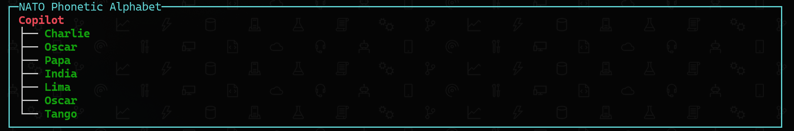

# NATO Phonetic CLI

A file-based .NET command-line app that converts a word to the NATO phonetic alphabet and displays the result as a Spectre.Console live tree.



## Usage

```shell
dotnet run src/script.cs -- copilot
```

## Source

- **[`src/script.cs`](src/script.cs)**: Primary source code
